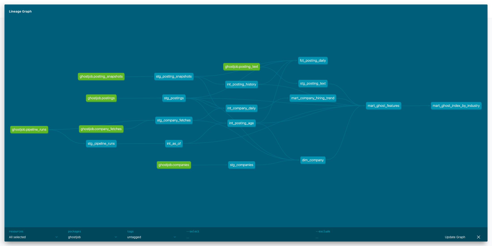

# analytics

## EDA notebook (Phase 3)

[`01_eda.ipynb`](01_eda.ipynb) covers data quality, days open, reposting, salary transparency and a survival curve. The
write-up is [`docs/FINDINGS.md`](../docs/FINDINGS.md). Re-run it top to bottom with `make eda` (local DB), or point it
at the hosted DB with `DATABASE_URL=<neon url> make eda`. Charts go to `docs/figures/`.

## dbt models (Phase 2)

`make dbt` builds every model and runs every data test against `DATABASE_URL` (the local Docker DB by
default). `make dbt-docs` opens the docs site with the lineage graph.

| Layer | Schema | Models | What it does |
|---|---|---|---|
| Staging | `staging` (views) | `stg_companies`, `stg_postings`, `stg_posting_snapshots`, `stg_posting_text`, `stg_pipeline_runs`, `stg_company_fetches` | Renames columns and adds simple helper fields: `has_salary`, `salary_range_ratio`, `is_date_refresh`, size midpoints. No business logic. |
| Intermediate | `intermediate` (views) | `int_as_of`, `int_posting_age`, `int_posting_history`, `int_company_daily` | Days open (with the ATS-date backfill), per-posting history (date refreshes, edits), daily open/new/closed roles per company. |
| Marts | `marts` (tables) | `dim_company`, `fct_posting_daily` (view), `mart_company_hiring_trend`, `mart_ghost_features`, `mart_ghost_index_by_industry` | What the model, the API and the Insights page read. |

**Tests:** 80 data tests cover keys (`unique`, `not_null`), relationships between tables, allowed values
(ATS, industry, seniority, remote type) and value ranges. The `between`, `unique_combination` and
`exactly_one_row` tests are small custom macros in `macros/`, so no extra dbt packages are needed.

**When it runs:** after the pipeline in the daily GitHub Actions job, and in CI on every push (against an empty,
migrated database).

**Notes:**
- Every "as of today" number uses the date of the latest successful run (`int_as_of`), not `current_date`. Results
  are reproducible from the same data.
- Days a company's board failed to fetch are gaps in `mart_company_hiring_trend`, not zeros.
- `mart_ghost_features` already has every column the Phase 6 model needs. The ones that later phases produce are
  NULL until then:
  - `repost_count_180d` and `boilerplate_similarity`: Phase 4
  - `vagueness_score` and `evergreen_flag`: Phase 5
  - `company_layoff_90d`: WARN data
