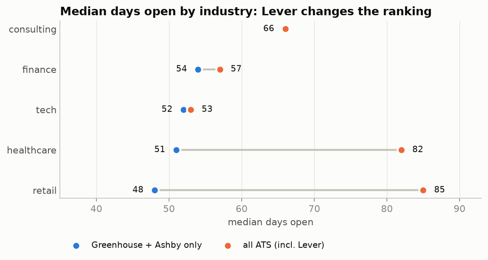
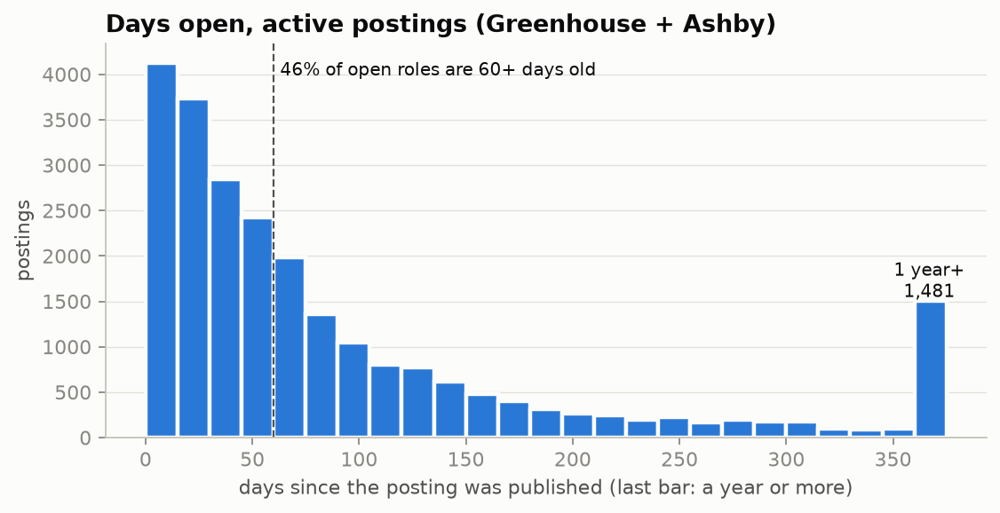
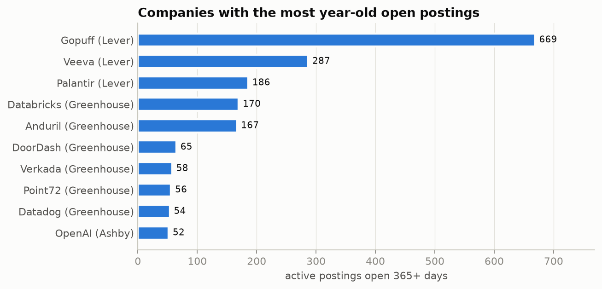
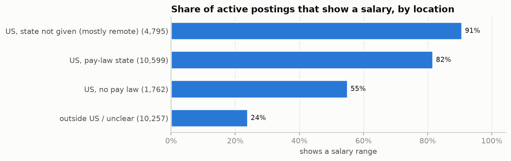
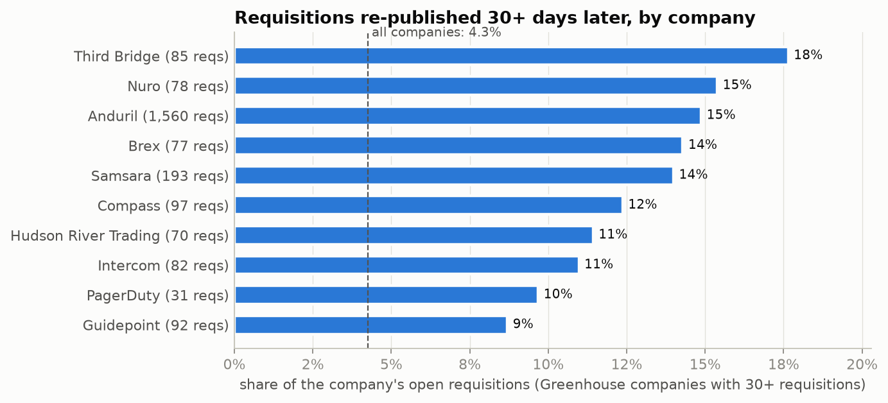

# Findings: the first snapshot (Phase 3)

**Data:** 27,413 active postings from 208 company job boards (Greenhouse, Lever and Ashby), as of 2026-11-21.
**Source:** [`analytics/01_eda.ipynb`](../analytics/01_eda.ipynb), run against the production database. Every number below is
also in [`figures/findings_numbers.json`](figures/findings_numbers.json), which the notebook writes.

**Caveat:** this is a single day of observation. These findings describe what is open *right now*. Questions
about how long postings take to close need history: the [survival curve](#what-we-cant-say-yet) fills in as the
daily job runs.

---

## 1. Posting age means different things on different ATSs, and it changes the industry ranking

**42% of Lever postings are over a year old, compared with 6.5% on Greenhouse and 4.2% on Ashby.** Lever's
`createdAt` is when the posting record was made, and companies keep one Lever posting open for years. On
Greenhouse, a re-published role usually gets a new date.

This changes the ranking of industries. With every ATS included, retail (median **85 days**) and healthcare
(**82 days**) look the stalest. With Greenhouse + Ashby only, they're among the freshest (**48** and **51 days**),
and consulting is the stalest (**66 days**). The early "healthcare and retail are stalest" signal from Phase 2 came
from a few large Lever boards.

| Industry | Median days open, all ATS | Median days open, Greenhouse + Ashby |
|---|---:|---:|
| Consulting | 66 | 66 |
| Finance | 57 | 54 |
| Tech | 53 | 52 |
| Healthcare | 82 | 51 |
| Retail | 85 | 48 |

**So what:** comparing posting age across companies on different ATSs is comparing different things. The Ghost
Score model (Phase 6) will measure age relative to the ATS. Once we have enough history, it will use the date
GhostJob first saw the posting.

## 2. Almost half of open roles have been up for two months or more

Using Greenhouse + Ashby only (24,339 postings), the **median posting has been open 53 days**. **46%** have been
open 60+ days, and **15%** have been open 180+ days. The distribution has a long tail, with a spike of 1,500
postings that are a year old or more.

**So what:** a role open for 60+ days isn't unusual, so age alone can't flag a ghost job. It's one input
alongside reposting, salary and text signals.

## 3. Year-old postings are concentrated in a handful of companies

**2,768 active postings (10%) are a year or more old, and 10 companies account for 64% of them.** Gopuff alone has
669 (89% of its board). Veeva has 287 and Palantir has 186, both on Lever. Two Greenhouse companies also stand out:
Databricks (170) and Anduril (167).

| Company (ATS) | Year-old postings |
|---|---:|
| Gopuff (Lever) | 669 |
| Veeva (Lever) | 287 |
| Palantir (Lever) | 186 |
| Databricks (Greenhouse) | 170 |
| Anduril (Greenhouse) | 167 |
| DoorDash (Greenhouse) | 65 |
| Verkada (Greenhouse) | 58 |
| Point72 (Greenhouse) | 56 |
| Datadog (Greenhouse) | 54 |
| OpenAI (Ashby) | 52 |

**So what:** "stale postings" are mostly a company-level habit (evergreen pipelines), not a market-wide one. The
model needs company-level features such as the share of the board that is old, not just posting-level ones.

## 4. Salary transparency follows the law

**82% of postings in US states with a pay-transparency law show a salary, compared with 55% in US states without
one.** It's **91%** for US postings with no state given (mostly remote roles, which usually fall under laws like
Colorado's). Outside the US, it's **24%**.

| Location group | Postings | Shows a salary |
|---|---:|---:|
| US, state not given (mostly remote) | 4,795 | 91% |
| US, pay-law state (CA, CO, WA, NY, IL, MN, HI, MD, MA, NJ, VT, DC) | 10,599 | 82% |
| US, no pay law | 1,762 | 55% |
| Outside US / unclear | 10,257 | 24% |

**So what:** a missing salary in California means something different from a missing salary in London. The
"no salary" feature in the model will be read in light of location.

## 5. 4% of Greenhouse requisitions have been re-published, rising to 15–18% at some companies

Greenhouse links every post to its **requisition** (`internal_job_id`). Of 16,435 open requisitions, **12% have more
than one live post**. Most of these are multi-city copies published the same day. However, **4.3% have posts
published 30+ days apart**: the same requisition was posted again. At Third Bridge it's **18%**, at Nuro **15%**,
at Anduril **15%** (of 1,560 requisitions), and at Brex and Samsara **14%**.

**So what:** this is a repost signal we can see on day one, without history or embeddings. It covers Greenhouse
only (73% of postings). Phase 4 adds text-similarity repost detection that works on every ATS and catches
reposts under a new requisition.

---

## Data-quality notes

- **No duplicate keys and no postings dated in the future.** The single impossible salary (a USD range of
  $152,405 to $179,300,152, two numbers run together) is now dropped by `sanitize_salary`. Amounts over 2M in
  INR, KRW, HUF and similar currencies are normal.
- **Greenhouse's `updated_at` is unreliable for some companies.** At **19%** of Greenhouse companies (with 20+
  postings), 80%+ of postings share a single `updated_at` day: someone bulk-touched the board. A "refreshed"
  posting at those companies isn't a signal. Phase 6 will only count a refresh that is specific to that posting.

## What we can't say yet

- **How long postings take to close (the survival curve).** The notebook has a Kaplan-Meier estimate that accounts
  for censoring (postings still open) and late entry (postings already old when we first saw them). After one day
  there are only 7 closures, too few to fit. It needs about 30 daily runs. `make eda` re-runs the notebook.
- **Close-then-repost rates.** These need a posting to disappear and come back, which takes weeks of history
  plus Phase 4's embeddings.
